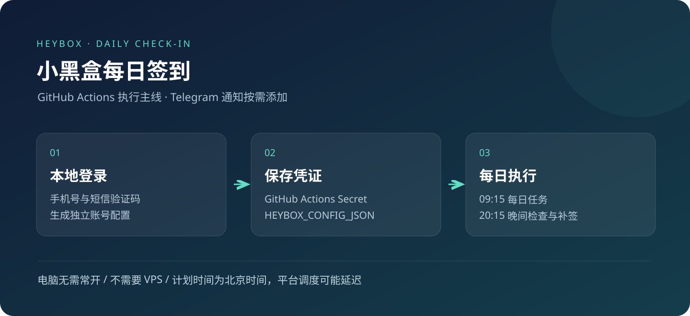
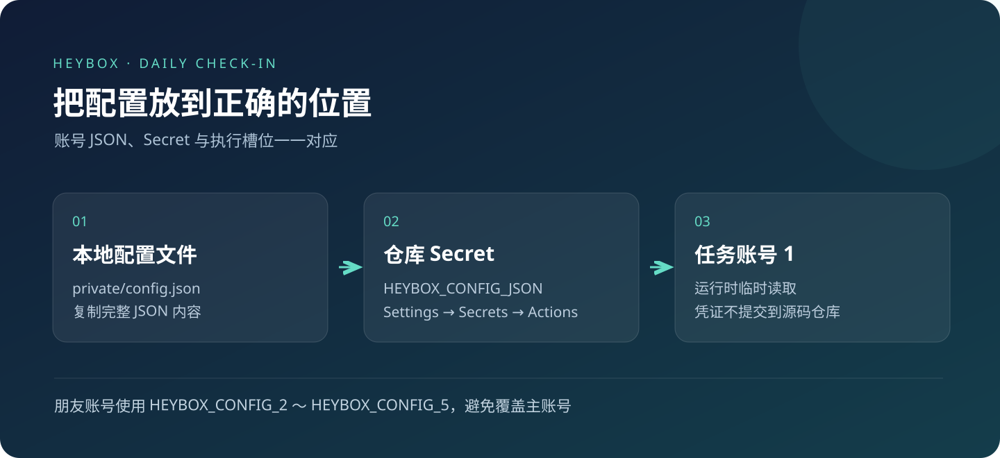
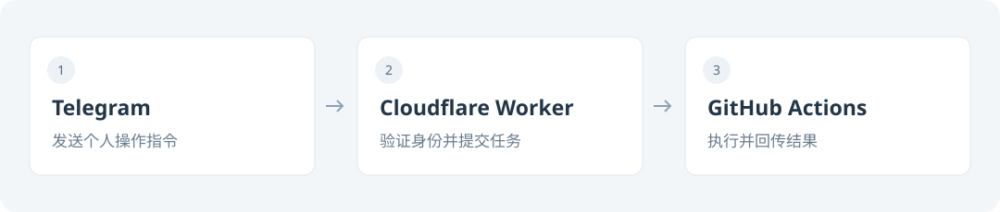

用 **GitHub Actions** 运行小黑盒每日任务：电脑只在首次登录时使用，之后由工作流按时执行。先把自动签到跑通；需要消息通知、手动补签或切换账号时，再接入后面的 Telegram Bot。



> **源码与致谢**
> 本文基于 [Cansiny0320/heybox-daily](https://github.com/Cansiny0320/heybox-daily)，原作者 [Cansiny0320](https://github.com/Cansiny0320)。签到与登录能力来自原项目，本文附带的 Actions 工作流、晚间兜底和 Telegram 菜单属于额外适配，不能仅克隆原项目就期待出现全部功能。原项目许可证和第三方声明继续保留。

<!-- more -->

## 一、先看部署路线

**只要自动签到：** 完成第二节即可。只需要 GitHub、小黑盒账号和一台用于首次登录的电脑。

**还想接收通知：** 完成第二节后，选配第三节的 Telegram 通知。

**还想在聊天中操作：** 再完成第四节，接入 Cloudflare Worker。可以查看状态、补签、执行每日任务和查看抽奖活动。

不需要购买 VPS 或域名，使用平台免费额度即可起步。多账号和频繁构建会增加 Actions 用量，请在平台用量页面检查额度。本文按 2026-11-23 的实现整理；接口、依赖和控制台界面变化时，需要对照原项目调整。

## 二、GitHub Actions 每日签到

### 第 1 步：准备自己的仓库

打开 [原作者仓库](https://github.com/Cansiny0320/heybox-daily)，点击右上角 **Fork**，创建到自己的账号下。也可以导入到自己的空仓库。

在电脑上克隆你自己的仓库：

```powershell
git clone https://github.com/你的用户名/你的仓库名.git
cd 你的仓库名
```

原项目本身支持本地或 Docker 执行。要使用本文的每日运行与晚间补签，先下载下面两个扩展文件，去掉末尾的 `.txt`，按对应路径放入仓库：

- [任务命令扩展：cli.ts](/downloads/heybox-guide/1-cli.ts.txt) → `src/cli.ts`
- [定时工作流：heybox-daily.yml](/downloads/heybox-guide/2-heybox-daily.yml.txt) → `.github/workflows/heybox-daily.yml`

工作流依赖扩展后的 `sign-only` 命令，两个文件需要一起安装。已有源码请先创建分支并核对差异；本文附件适配的是验证时的版本，未来上游版本需要合并而非直接覆盖。不要覆盖本地账号配置。

安装完成后，把这两个文件提交到自己仓库的默认分支 `main`：

```powershell
git add src/cli.ts .github/workflows/heybox-daily.yml
git commit -m "Add scheduled daily tasks"
git push origin main
```

打开仓库顶部 **Actions**，按提示启用工作流。若看不到文件，检查是否已推送到默认分支。

### 第 2 步：在本地登录


在仓库目录打开 PowerShell，检查并安装依赖：

```powershell
node --version
git --version
npm install --global pnpm@12.15.0
pnpm install --frozen-lockfile --ignore-scripts
pnpm build
node dist/cli.js login
```

安装和构建必须成功后再运行登录。程序先获取设备令牌，再提示手机号和短信验证码，国内号码默认使用 +86。只输入自己或经授权账号的信息，验证码不发进 Telegram 聊天。

登录成功生成 `private/config.json`。验证码可在同一会话内最多提交 3 次，回车取消；程序不会自动重发短信。遇到频率限制、过期或人机验证按报错处理，简单本地入口不保证完成所有人机验证。

如果当前窗口设置过 `HEYBOX_CONFIG`，保存路径会受影响。主账号登录前可在当前 PowerShell 执行：

```powershell
Remove-Item Env:HEYBOX_CONFIG -ErrorAction SilentlyContinue
node dist/cli.js login
```

可选 Docker 方案：电脑安装并启动 Docker Desktop 后，在仓库运行：

```powershell
docker compose build heybox login
docker compose run --rm login
docker compose run --rm heybox check
```

打开 `private/config.json`，复制包含最外层大括号的完整 JSON，保存为 GitHub Secret `HEYBOX_CONFIG_JSON`。不要只复制某个字段，不要额外包一层引号。`private/` 被 Git 忽略，仍不要强制上传。

### 第 3 步：把凭证保存到 GitHub

进入 **仓库 → Settings → Secrets and variables → Actions → Secrets**。

1. 点击 **New repository secret**。
2. **Name** 填 `HEYBOX_CONFIG_JSON`。
3. **Secret** 粘贴 `private/config.json` 的完整内容，包括最外层大括号。
4. 点击 **Add secret** 保存。

这一步只需要一个账号 Secret。Cloudflare Token、GitHub PAT 和 Telegram Token 都是后面可选功能的配置，不必现在创建。



保存后无法查看旧值是正常的。需要换凭证时点右侧铅笔更新；不要为了核对而把内容回显到日志。

### 第 4 步：手动运行一次

打开 **Actions → Heybox Daily → Run workflow**：

1. 分支选择 `main`。
2. 第一次可以不勾选“只检查和补签”，测试完整每日任务。
3. 确认运行，打开最新记录。
4. 查看账号 1 的构建和任务步骤是否成功，再去小黑盒核对实际签到状态。

当前工作流预留 5 个槽位，未配置的账号会跳过主要步骤。只配了账号 1 时，不需要为其他槽位填写任何东西。

**做到这里，每日自动签到就已配置完成。** 后面的 Telegram Bot 是可选项。

### 每天什么时候执行？


工作流 `.github/workflows/heybox-daily.yml` 使用 UTC cron：

```yaml
schedule:
  - cron: '15 1 * * *'  # 北京时间 09:15
  - cron: '15 12 * * *' # 北京时间 20:15
```

代码通过 `15 12 * * *` 这个字符串识别晚间任务。修改晚间 cron 时必须同步修改 `TASK_COMMAND` 对应判断，否则可能执行完整每日任务。

5 个槽位当前按矩阵顺序、最多 1 个并行执行。空槽位跳过主要步骤，后面的账号可能更晚通知。晚间已签到时静默，补签成功或检查失败才通知；手动 `/sign` 会报告操作结果。

通知里“部署实践中 H 币变化”是此次任务前后差值，不是当天全部来源的累计收入。查询余额不能代表所有奖励已经到账。

GitHub 调度可能延迟，高负载时甚至丢弃任务，计划 09:15 不保证准点到达。晚间兜底提高恢复机会，仍不能保证不断签。[官方调度说明](https://docs.github.com/en/actions/reference/workflows-and-actions/events-that-trigger-workflows#schedule)。公开库 60 天没有活动可能自动停用定时工作流，需检查启用状态。[官方停用说明](https://docs.github.com/en/actions/how-tos/manage-workflow-runs/disable-and-enable-workflows)。

担心断签时先 `/status`，未签再 `/sign`。也可 Actions → Heybox Daily → Run workflow 勾选只检查和补签；这个工作流处理全部已配置账号，机器人指令处理单账号。

## 三、可选：用 Telegram 接收结果

如果只想看 GitHub 的执行日志，可以跳过这一节。希望每天在手机收到结果，则先创建 Bot，再保存两个 Secret。

### 创建 Telegram 机器人

#### 创建身份

1. Telegram 打开官方 [@BotFather](https://t.me/BotFather)，发送 `/newbot`。
2. 输入显示名称，如“自动任务助手”。
3. 输入唯一用户名，建议以 `bot` 结尾；被占用则更换。
4. 复制创建成功消息中的 Token，保存到 Secret `TG_BOT_TOKEN`。
5. 打开自己新机器人的私聊，发送普通 `/start`。

刚创建时不回复正常：BotFather 只创建身份，后面的 Worker 部署负责回复。不要只给 BotFather 发 `/start`，也不用拼接以前的引导字符串。

#### 获取 TG_CHAT_ID

首次尚未设置 webhook 时，给自己的机器人发一条消息，再在 PowerShell 输入 Token 查询：

```powershell
$secureToken = Read-Host '输入 Bot Token' -AsSecureString
$botToken = [System.Net.NetworkCredential]::new('', $secureToken).Password
$updates = Invoke-RestMethod -Uri "https://api.telegram.org/bot$botToken/getUpdates"
$updates.result | ForEach-Object { $_.message.chat } | Select-Object id, type
Remove-Variable botToken, secureToken, updates
```

选择你自己对应的 `private` 私聊 id，保存为 `TG_CHAT_ID`。结果为空先给机器人发新消息再查询。

已经设置 webhook 后不能同时使用 getUpdates；已部署管理员保留原 Chat ID，勿为查询 ID 随意删除线上 webhook。[Telegram 官方说明](https://core.telegram.org/bots/faq)。

#### 头像、简介和快捷菜单

BotFather 发送 `/mybots`，选机器人，在 **Edit Bot** 中修改头像、名称、Description、About。也可使用 `/setuserpic`、`/setdescription`、`/setabouttext` 按提示操作。

本文扩展方案部署流程自动注册 `/` 命令菜单，不需要每次到 BotFather 重设。输入框输入 `/` 可查看；有缓存时退出对话重新进入。

> 仅发通知需要 `TG_BOT_TOKEN` 和 `TG_CHAT_ID`，无需配置 Cloudflare 或 GitHub 调度令牌。

保存 Telegram 两项后，再手动运行一次 **Heybox Daily**。正常会收到账号、任务状态和 H 币情况。通知不包含仓库链接；晚间检查发现已签时保持安静，漏签补签或检查失败时才提醒。

## 四、可选：给机器人加操作菜单

这部分会增加 Cloudflare Worker、KV 和 GitHub 调度令牌。它们负责接收指令并提交任务；实际签到仍由 GitHub Actions 执行。



### 生成 webhook 密钥

PowerShell 运行：

```powershell
[Convert]::ToHexString([System.Security.Cryptography.RandomNumberGenerator]::GetBytes(32))
```

将生成值保存为 Secret `TG_WEBHOOK_SECRET`。它与 Bot Token、Cloudflare Token、GitHub PAT 是四种不同的值。部署自动同步到 Worker 与 Telegram，抽奖确认也使用它。

### 先补齐交互功能文件

下载本文末尾的配套附件，按原路径放入仓库。除第二节已有的两个文件外，还需要 Telegram 指令工作流、Worker 部署工作流、通知脚本、Worker 源码与 Wrangler 配置。

先将 `telegram-worker/wrangler.jsonc` 的 `GITHUB_OWNER`、`GITHUB_REPO` 改成自己的用户名与仓库名。KV ID 在创建空间后再填写。将扩展提交到自己仓库后继续配置。

<details>
<summary><strong>展开：交互机器人需要的 Secrets 与 Variable 对照表</strong></summary>


入口：**目标仓库 → Settings → Secrets and variables → Actions**。这是仓库设置，不是个人令牌设置。

新增 Secret：切到 **Secrets → New repository secret**；Name 填指定名称，Secret 填实际内容，点击 Add secret。已有项点铅笔或 Update 更新。保存后看不到旧值是正常现象。

| Secret 名称 | 填什么 |
| --- | --- |
| `HEYBOX_CONFIG_JSON` | 主账号完整配置 JSON |
| `HEYBOX_CONFIG_2`～`HEYBOX_CONFIG_5` | 可选的其他账号独立 JSON |
| `TG_BOT_TOKEN` | BotFather 签发的机器人 Token |
| `TG_CHAT_ID` | 管理员与机器人私聊的数字 chat ID |
| `TG_WEBHOOK_SECRET` | 自己生成的随机密钥 |
| `BOT_GITHUB_TOKEN` | 只授权目标仓库 Actions 读写的 GitHub PAT |
| `CLOUDFLARE_API_TOKEN` | Cloudflare Worker 部署令牌 |
| `CLOUDFLARE_ACCOUNT_ID` | Cloudflare 账户 ID |

仅定时签到可以先只配账号凭证；通知需 Telegram 两项；交互机器人需完成其余对应配置。

切到 **Variables → New repository variable** 新增：

| Variable 名称 | 填什么 |
| --- | --- |
| `TELEGRAM_WORKER_URL` | Worker 根地址，例如 `https://heybox-telegram-bot.你的子域.workers.dev` |

注意：本文扩展直接从 `telegram-worker/wrangler.jsonc` 读取 KV ID。之前即使添加过 `CLOUDFLARE_KV_ID` Variable，也不会自动替换配置文件。

</details>

### 创建 Cloudflare Worker 与 KV

已创建正确资源的用户复用即可。界面可能中英混合，下面按实际遇到的中文按钮描述。

#### 创建 Worker

1. 进入 [Cloudflare 控制台](https://dash.cloudflare.com/)，选择自己的账户。
2. 左侧 **计算 → Workers 和 Pages**，点击创建应用或 Worker。
3. “创建新项目”选择 **从 Hello World! 开始**。
4. 名称填 `heybox-telegram-bot`，点击部署。
5. 进入 Worker，点击右上角 **访问**，或查看 **域/域和路由**。

不选择 Upload your static files；后续 GitHub 工作流会替换初始 Hello World 代码。

地址形如 `https://heybox-telegram-bot.你的子域.workers.dev`。“你的子域”是账户的 workers.dev 子域，不是机器人用户名，也不是 KV ID，不需要付费域名。以控制台显示的完整地址为准。

把这个根地址存为 GitHub Variable `TELEGRAM_WORKER_URL`，不用加 `/telegram`，部署流程自动补齐。

#### 创建 KV 空间

1. 左侧 **存储和数据库 → Workers KV**。
2. 点击 **创建 KV 命名空间**。
3. 名称填 `heybox-telegram-bot-state`。
4. 创建后记录它的 ID。
5. 空间内显示“当前没有任何条目”正常，机器人使用后才写状态。

不要混用其他网站已经在使用的空间。

#### 绑定到 Worker

1. **Workers 和 Pages → heybox-telegram-bot → 设置 → 绑定**。
2. 点击 **添加绑定**，左侧选择 **KV 命名空间**。
3. 如果右侧只有介绍和代码示例，点击右下角 **添加绑定** 进入填写步骤，示例代码不用修改。
4. 变量或绑定名称填 **`BOT_STATE`**，必须一致。
5. 空间选刚创建的 `heybox-telegram-bot-state`，保存/部署。

成功后列表应显示：类型 KV 命名空间，名称 BOT_STATE，值为新空间名称。

#### 同步 Wrangler 配置

如果页面提示“更新您的 Wrangler 配置”，还需打开仓库 `telegram-worker/wrangler.jsonc` 同步以下字段并提交：

```jsonc
{
  "name": "heybox-telegram-bot",
  "main": "src/worker.js",
  "compatibility_date": "2026-11-22",
  "workers_dev": true,
  "vars": {
    "GITHUB_OWNER": "你的GitHub用户名",
    "GITHUB_REPO": "你的仓库名"
  },
  "kv_namespaces": [
    { "binding": "BOT_STATE", "id": "你自己的KV空间ID" }
  ]
}
```

示例展示关键字段，原文件其他适用配置可以保留。不能沿用原作者或本文扩展方案维护者的资源 ID。

| 容易混淆的值 | 来源 | 填到哪里 |
| --- | --- | --- |
| 账户 ID | Cloudflare 账户信息/API 页面 | Secret `CLOUDFLARE_ACCOUNT_ID` |
| KV 命名空间 ID | Workers KV 列表或空间设置 | Wrangler 的 `kv_namespaces[].id` |
| Worker 地址 | Worker 的访问/域和路由 | Variable `TELEGRAM_WORKER_URL` |

### 创建 Cloudflare 部署令牌

1. Cloudflare 找到 **账户 API 令牌**，也可从个人资料 API 令牌入口进入对应管理页。
2. 点击 **创建令牌**，名称如 `Heybox Telegram Deploy`。
3. 权限模板选择 **Edit Cloudflare Workers**。
4. 资源范围选择目标账户，确认包含要部署的 Worker 和所用资源。
5. 不必选 Write all resources / Full account and zone access。
6. 有效期按维护计划选择；过期需更新 Secret。长期部署可无过期时间并主动轮换。
7. **客户端 IP 地址过滤留空**，GitHub 托管 Runner 的出口 IP 会变化。
8. 查看摘要并创建，立即复制 Token。

不要只根据旧教程寻找“Workers 脚本”字样：Cloudflare 新界面可能显示 Workers Editor/Admin 等粒度。Editor 用于更新已有 Worker，创建/删除需要相应管理权限；KV 等操作也需对应权限。优先用适用的 Workers 模板，具体以 [Cloudflare 官方权限说明](https://developers.cloudflare.com/workers/authorization/) 和错误日志为准。

GitHub 仓库 Secrets 中保存：`CLOUDFLARE_API_TOKEN` 填完整 Token，`CLOUDFLARE_ACCOUNT_ID` 填账户 ID。Token 不带引号、Bearer、空格或多余换行。

创建后不再显示原文正常。曾经出现在公开截图、聊天、代码或日志中的令牌应撤销换新；本文不收录任何历史真实 Token。

### 创建 GitHub 调度令牌

这个 PAT 供 Worker 触发 Telegram Command，不是 Cloudflare 部署令牌。

1. GitHub 头像 → **Settings → Developer settings → Personal access tokens → Fine-grained tokens**。
2. 点击 **Generate new token**，或打开 [创建页](https://github.com/settings/personal-access-tokens/new)。
3. 名称如 `heybox-telegram-dispatch`。
4. **Resource owner** 选拥有目标仓库的账号。
5. **Repository access → Only select repositories**，只选目标仓库。
6. **Repository permissions → Actions → Read and write**；Metadata 自动只读即可。
7. 选择过期时间并记录维护日期，组织库有审批要求时需审批通过。
8. 创建后复制，保存到仓库 Secret **`BOT_GITHUB_TOKEN`**。

后续部署自动把该 Secret 写入 Worker，无需在 Cloudflare 重复手填。若 Token 更新，必须再部署一次 Worker 才会同步。

### 部署与验收

#### 手动部署

仓库 **Actions → Deploy Telegram Bot → Run workflow**，分支选 `main`，确认运行并打开最新记录。

修改 `telegram-worker/` 或部署工作流后推送到 main 也会自动发布。**只修改 Secret 不会自动部署**，需要手动运行。

| 关键步骤 | 预期结果 |
| --- | --- |
| Deploy Worker | Worker 代码与 KV 绑定成功 |
| Configure Worker secrets | Telegram、GitHub 调度和 webhook 密钥写入成功 |
| Register Telegram webhook | `/telegram` 回调注册成功 |
| Register Telegram command menu | `/` 快捷菜单注册成功 |

四项都应成功。根地址返回 `Heybox Telegram bot is running.` 只证明 Worker 可访问，不能单独证明所有配置正确。部署注册 webhook 会丢弃当时尚未投递的旧更新，部署期间发送的指令可能需要重发。

#### 验收顺序

1. 私聊自己的机器人发送 `/start`，看到菜单。
2. `/accounts` 选择账号 1，再 `/status`。
3. 等待 GitHub 构建和执行，核对返回的盒友 ID、签到和盒币状态。
4. Actions 检查对应 Telegram Command 是否成功。
5. `/activities` 获取活动，只查看不会参与。
6. 确认账号正确后再使用签到、任务或活动参与按钮。

任务需要排队、构建和访问上游，可能等待几分钟，不是 Worker 即时完成。已提示提交成功时避免重复点击。

### 操作菜单与抽奖

| 命令 | 行为 |
| --- | --- |
| `/start` | 打开当前账号操作菜单 |
| `/accounts` | 切换当前管理账号 |
| `/status` | 查询签到、分享、经验、H 币和盒友 ID |
| `/sign` | 检查并补签 |
| `/run` | 执行每日任务 |
| `/activities` | 获取抽奖活动列表 |

普通命令使用当前账号；旧消息的操作按钮绑定消息生成时的账号，切换后仍操作原账号。建议切换后重新 `/start` 使用新菜单。

抽奖依次点击“抽奖活动 → 某活动详情 → 确认参与”。需要关注时详情会显示要求，确认按钮为“确认关注并参与”。条件变化需重新查看确认。确认凭证也绑定账号，不能跨账号复用。被限制、已结束或不满足前置条件的活动可能无法执行。

没有每日自动批量抽奖。参与成功不代表中奖，资格和奖品由小黑盒决定。

## 五、可选：由管理员管理多个账号


由管理员取得朋友授权后在本地登录，分别存储。最多 5 个槽位：

| 槽位 | 本地文件 | GitHub Secret |
| --- | --- | --- |
| 1 | `private/config.json` | `HEYBOX_CONFIG_JSON` |
| 2 | `private/account-2.json` | `HEYBOX_CONFIG_2` |
| 3 | `private/account-3.json` | `HEYBOX_CONFIG_3` |
| 4 | `private/account-4.json` | `HEYBOX_CONFIG_4` |
| 5 | `private/account-5.json` | `HEYBOX_CONFIG_5` |

完成本地依赖安装、构建后，在仓库 PowerShell 运行：

```powershell
.\scripts\login-account.ps1 -Account 2
```

输入朋友手机号和验证码。成功后生成独立的 `private/account-2.json`。脚本检测到该文件已存在会停止，避免误覆盖。

若系统阻止 PowerShell 脚本，可直接在当前窗口指定文件并登录，不必更改全局安全设置：

```powershell
$env:HEYBOX_CONFIG = Join-Path (Get-Location) 'private/account-2.json'
node dist/cli.js login
Remove-Item Env:HEYBOX_CONFIG -ErrorAction SilentlyContinue
```

直接命令成功后会更新指定文件，先核对已有文件是否属于正确账号。

打开新 JSON，完整复制到 GitHub 新 Secret `HEYBOX_CONFIG_2`。不要把它存到主账号的 `HEYBOX_CONFIG_JSON`。然后机器人 `/accounts` 选账号 2，`/status` 核对盒友 ID。账号 3～5 同理替换数字。

保存后自动加入下一次定时执行，无需部署 Worker。不要把同一账号重复配置到多个槽位。当前菜单总显示 5 个槽位，未配置的槽位操作时提示缺配置，不会回退使用主账号；尚无自动显示所有账号昵称的功能。

## 六、附件、排错与维护

<details>
<summary><strong>配套扩展下载与文件路径</strong></summary>

先从原作者仓库获得源码：

```powershell
git clone https://github.com/Cansiny0320/heybox-daily.git
cd heybox-daily
```

把下面文件下载后，去掉文件名末尾的 `.txt`，按右侧目标路径放入本地仓库。GitHub 网页上传时要确保隐藏目录名称仍为 `.github`。建议先创建独立分支保存原版，再审阅差异；已有登录配置不要覆盖。

| 附件 | 放入项目的路径 |
| --- | --- |
| [src/cli.ts](/downloads/heybox-guide/1-cli.ts.txt) | `src/cli.ts` |
| [.github/workflows/heybox-daily.yml](/downloads/heybox-guide/2-heybox-daily.yml.txt) | `.github/workflows/heybox-daily.yml` |
| [.github/workflows/telegram-command.yml](/downloads/heybox-guide/3-telegram-command.yml.txt) | `.github/workflows/telegram-command.yml` |
| [.github/workflows/deploy-telegram-bot.yml](/downloads/heybox-guide/4-deploy-telegram-bot.yml.txt) | `.github/workflows/deploy-telegram-bot.yml` |
| [scripts/telegram-report.mjs](/downloads/heybox-guide/5-telegram-report.mjs.txt) | `scripts/telegram-report.mjs` |
| [scripts/login-account.ps1](/downloads/heybox-guide/6-login-account.ps1.txt) | `scripts/login-account.ps1` |
| [telegram-worker/src/worker.js](/downloads/heybox-guide/7-worker.js.txt) | `telegram-worker/src/worker.js` |
| [telegram-worker/wrangler.jsonc](/downloads/heybox-guide/8-wrangler.jsonc.txt) | `telegram-worker/wrangler.jsonc` |
| [原项目 MIT 许可证副本](/downloads/heybox-guide/LICENSE.txt) | 保留项目原有 LICENSE，附件仅供阅读 |

`src/cli.ts` 包含本文需要的 `sign-only`、状态 JSON 与活动操作入口，不能只复制工作流而漏掉它。这是基于本文验证时的源码适配，不保证未来版本可以无冲突覆盖；如原仓库接口变化，请对照差异合并。原项目 NOTICE 与第三方许可继续保留。

附件中的 `telegram-worker/wrangler.jsonc` 已清除原部署信息，`YOUR_GITHUB_OWNER`、`YOUR_REPOSITORY`、`YOUR_KV_NAMESPACE_ID` 都需要填写；Worker 名称可按文章示例保留。

接下来创建自己的 GitHub 仓库并推送这份带扩展的源码，按正文配置 Secrets。以下“Telegram Command”等名称指附件提供的工作流，不是承诺原仓库默认已有。

</details>

<details>
<summary><strong>遇到错误时：按现象查找解决方法</strong></summary>

### 常见问题

#### Cloudflare Invalid access token / Authentication error

部署实践中遇到 Worker 部署约十几秒失败，日志有 `Invalid access token [code: 9109]` 和认证错误。替换有效部署令牌后成功，无需重建 KV 或 Worker。

依次核对 Secret 名称、Token 是否复制完整、过期或撤销、账户 ID、令牌类型与权限。不能仅凭错误 10000 断言具体原因。必要时重新使用 Edit Cloudflare Workers 模板创建令牌，替换 GitHub Secret，然后手动重新部署。

#### 机器人提交失败 / GitHub 401、403、404

检查 BOT_GITHUB_TOKEN 是否过期、Resource owner 是否正确、是否选择目标仓库、Actions 是否读写，以及 Worker owner/repo/分支。私有库未授权也可能 404。更新 PAT 后需要部署同步 Worker Secret。

#### KV 空白、绑定位置找不到、ID 分不清

新 KV 空白正常。先创建空间，再在 Worker 设置添加 BOT_STATE 绑定；只有示例介绍时点右下角添加绑定继续。账户 ID、KV ID、Worker URL 按上方表格分别填写，并同步 Wrangler 文件。

#### /start 无回复

确认私聊的是自己的机器人，TG_CHAT_ID 正确，Worker 部署四个步骤成功。非管理员消息会被忽略。BotFather 创建成功不代表回复程序已经上线。

#### 同一个机器人给其他项目发通知

每个仓库独立配置 Secrets，并在对应工作流接入通知。同一个 Bot 可以接收多个项目的结果，但不会自动订阅所有仓库。变量名以各项目的实现为准，连接测试消息也不能证明定时任务已经执行。

#### 定时 4 点没有运行、通知却很晚

先检查 UTC 时差：北京时间 04:00 是前一天 UTC 20:00，对应 `0 20 * * *`。再看默认分支、工作流启用、Actions 队列与额度。

从 Actions 创建时间、构建和执行日志区分调度延迟与任务耗时。Telegram 到达时间不能直接证明 cron 配错，多账号顺序也会延后消息。

#### 缺配置、登录失效、人机验证

核对槽位 Secret 名称和完整 JSON。登录失效需要本地重新登录并更新同槽位 Secret；不要覆盖其他账号。短信限制不要反复重发；设备令牌 SDK 变更或验证码要求可能需要进一步维护，不能通过乱改版本号解决。

#### CI 红叉、每次收到失败邮件

先区分 CI、Deploy Telegram Bot、Heybox Daily、Telegram Command。CI 测试失败不等于签到失败；部署成功也不等于完整测试全绿。

部署实践中修正过 Compose 项目名导致的 CI 问题，后来原网站集成测试又出现断言失败，仍需独立排查。减少邮件可在 GitHub 个人 Settings → Notifications → Actions 调整通知，或点击邮件底部管理链接。界面选项以当前账户为准；关通知不会修复失败，不建议为去红叉删除测试。

#### Node、pnpm、Docker 不存在或安装失败

安装对应软件并重开终端，Docker 还需启动服务。pnpm 首次依赖下载可能很慢，可选平台包下载失败属于本机依赖问题，先处理网络与安装，不要误当成账号登录错误。

</details>

<details>
<summary><strong>更新代码、暂停任务与轮换密钥</strong></summary>

### 维护、暂停和更新

本地更新先检查修改再拉取：

```powershell
git status
git pull --ff-only
pnpm install --frozen-lockfile --ignore-scripts
pnpm build
```

保留已有修改，不用强制覆盖。合并原项目更新时保留本文扩展方案工作流、Telegram 改造与自己的 Wrangler 配置，不使用原作者生产资源 ID。

| 要做什么 | 操作 |
| --- | --- |
| 停用朋友账号 | 删除对应配置 Secret；运行中的任务需另外在 Actions 取消 |
| 暂停全部定时签到 | Actions → Heybox Daily → 菜单 → Disable workflow |
| 同时暂停机器人执行 | 再停用 Telegram Command |
| 更新小黑盒配置 | 更新该槽位 Secret，下一次执行使用 |
| 更新 Bot Token / Chat ID / PAT / webhook 密钥 | 更新 Secret 后运行 Deploy Telegram Bot |
| 更新 Cloudflare Token | 更新 Secret，下次部署使用 |
| 改 Worker 地址 | 更新 TELEGRAM_WORKER_URL，再部署注册 webhook |
| 改 KV | 更新 Wrangler 配置并部署，账号选择状态可能重置 |

Secret 删除不会撤回已读取凭证的在途任务。菜单仍显示空槽位。同一个 Bot 不要被多套 webhook 服务竞争使用，轮换 webhook 密钥后旧活动确认可能失效，重新查看活动即可。

</details>

### 使用边界

本文方案由一个 Telegram 管理员统一管理，首次登录仍在本地完成。原作者网站的托管账号与自己的 GitHub 配置是不同系统，登录原作者网站不会自动为自己的仓库保存凭证。

已验证的范围包括 Worker 部署、命令注册、主账号的线上只读查询，以及按钮账号隔离的模拟测试。其他账号需要各自登录并核对盒友 ID。原网站集成测试曾出现独立失败，不能将机器人部署成功视为整个项目所有测试通过。

没有自动批量参加全部抽奖，也不能保证永久不断签。参与、关注及奖励以小黑盒实际状态为准。

源码与后续更新请查看 [原作者仓库](https://github.com/Cansiny0320/heybox-daily)，本地运行细节可参考 [原项目使用说明](https://github.com/Cansiny0320/heybox-daily/blob/main/docs/usage.md)。代码遵循原仓库 MIT License，第三方资源以原项目 NOTICE 为准。

